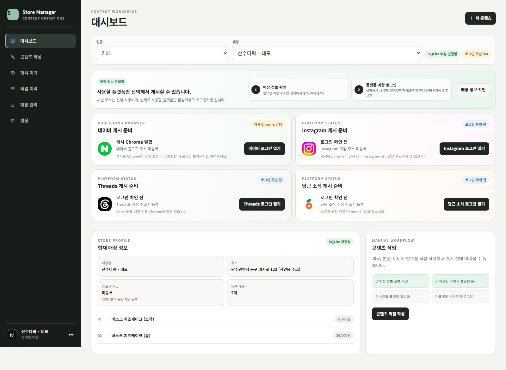
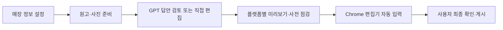
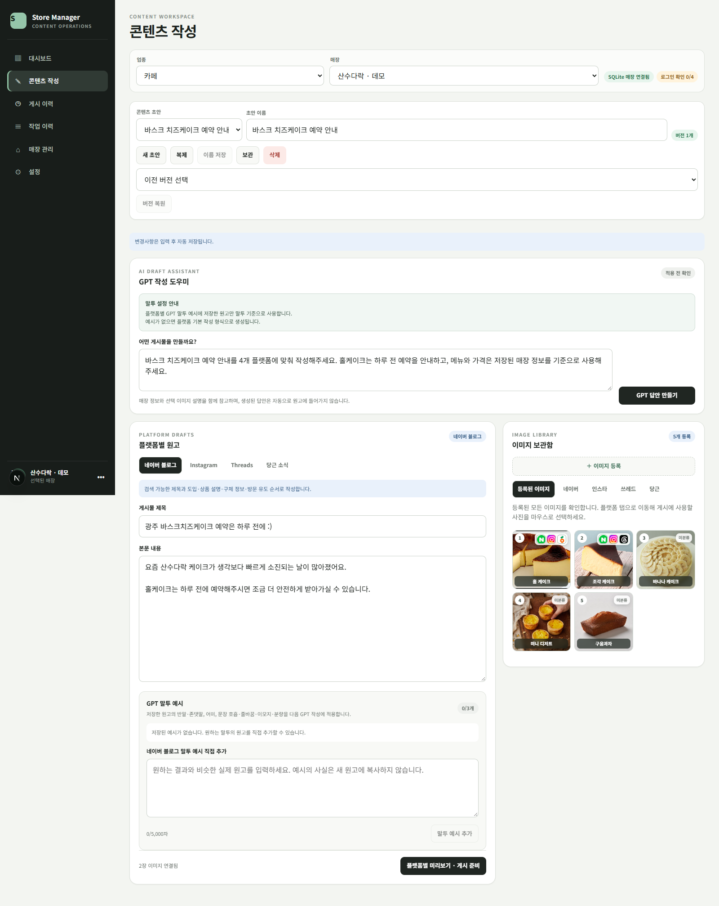
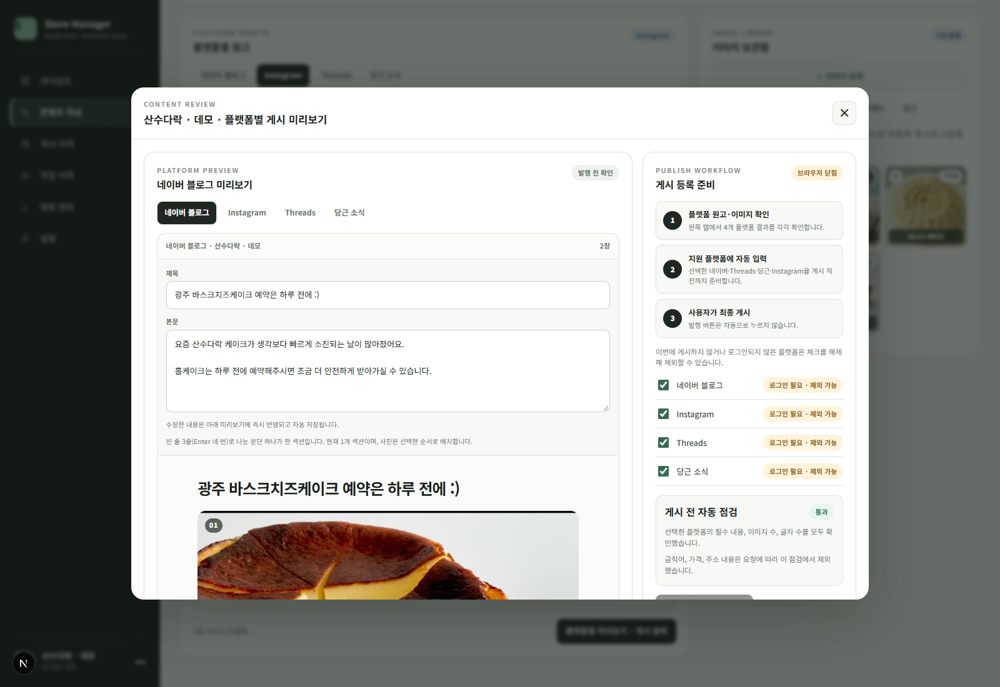
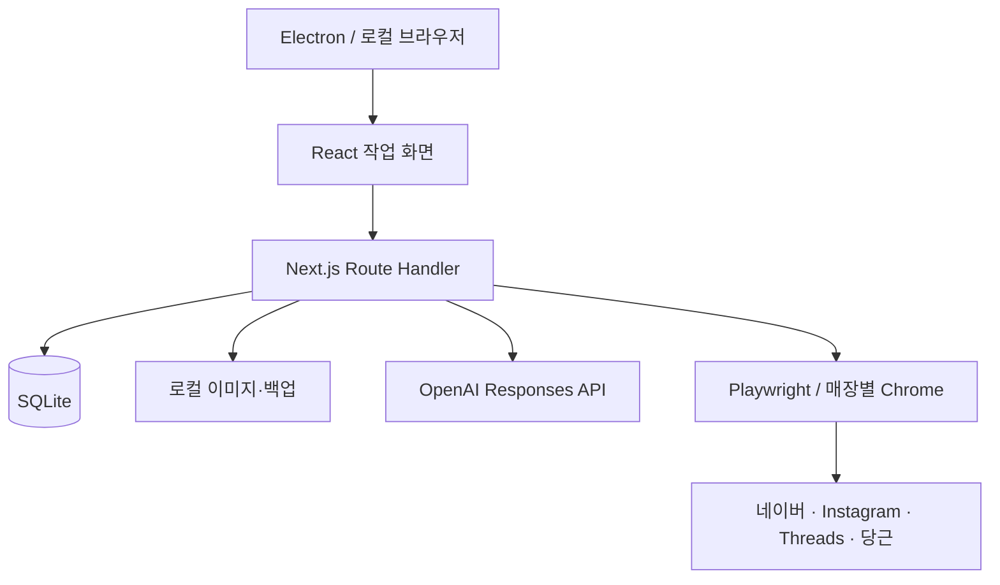

# BlogUploader

### 매장별 콘텐츠 작성부터 4개 플랫폼 게시 준비 프로그램

**Next.js · React · TypeScript · SQLite · Playwright · Electron**

[원본 소스](https://github.com/saintlucias/BlogUploader) · [전체 화면](docs/SCREENS.md) · [기술 설계](docs/ARCHITECTURE.md) · [구현 범위](docs/FEATURES.md)

## 프로젝트 소개

여러 매장의 홍보 콘텐츠를 네이버 블로그, Instagram, Threads, 당근 소식에 맞춰 작성하고, 각 플랫폼의 편집기에 원고와 이미지를 입력하는 **Windows용 로컬 데스크톱 앱**

매장 정보와 메뉴를 공통으로 관리하면서 플랫폼별 원고와 이미지 순서를 따로 편집할 수 있음. GPT 작성 도우미가 만든 답안은 검토 후 원고에 적용하며, 게시 전에는 미리보기와 입력 조건을 확인함.

**앱은 게시 직전까지 준비하고, 최종 발행·공유·등록은 사용자가 직접 진행.**

## 해결하려는 문제

| 매장 콘텐츠 운영에서의 반복 작업 | 구현한 흐름 |
| --- | --- |
| 매장마다 주소·메뉴·가격을 다시 확인 | 매장별 공식 정보와 메뉴를 SQLite에 저장 |
| 같은 소식을 플랫폼별 형식으로 다시 작성 | 4개 플랫폼 원고 분리, GPT 생성·개별 재작성·말투 예시 적용 |
| 사진을 다시 고르고 원고를 옮겨 입력 | 플랫폼별 이미지 선택과 순서 관리, Chrome 편집기 자동 입력 |
| 여러 초안을 오가다가 수정 내용을 잃음 | 자동 저장 큐, 전환 전 저장 완료, 이전 버전 복원 |
| 일부 플랫폼 실패 후 처리 상태를 다시 확인 | 플랫폼별 결과 즉시 기록, 성공·부분 실패·실패 구분 |

## 주요 기능

| 기능 | 구현 내용 |
| --- | --- |
| 매장 관리 | 다중 매장, 메뉴·가격, 주소·전화·영업시간·정기휴무·네이버 플레이스 URL |
| 콘텐츠 작업 공간 | 다중 초안, 복제·보관·삭제, 자동 저장, 문서별 최대 50개 버전 |
| GPT 작성 도우미 | 전체 플랫폼 생성, 플랫폼별 재질문, 답안 수정·보관·선택 적용, 플랫폼별 말투 예시 최대 3개 |
| 이미지 관리 | 매장별 보관함, 플랫폼별 선택·순서, 파일 검증과 해시 기반 중복 방지 |
| 게시 준비 | 원고·이미지 사전 점검, 플랫폼별 미리보기, 계정 확인과 편집기 자동 입력 |
| 이력·알림 | 작업별 결과, 입력 성공 이력, 게시물 URL 수동 기록, 게시 준비 시각 알림 |
| 데이터 관리 | SQLite·업로드 이미지 백업/복원, 복원 전 무결성 검사, 미사용 이미지 정리 |

## 사용 흐름

### 플랫폼별 원고와 이미지 편집

하나의 초안에서 플랫폼별 제목·본문을 관리. 사진 보관함에서 사용할 이미지를 배정하고, 말투 예시를 저장해 이후 GPT 작성에 적용할 수 있음.

### 게시 미리보기와 준비

입력할 원고와 이미지, 대상 플랫폼을 확인함. 로그인과 계정 상태를 점검한 뒤 외부 편집기에 내용을 채우며, 최종 게시 단계에서 사용자 확인을 받음.

매장 관리, Instagram 편집, 작업 이력, 설정 화면은 [전체 화면 안내](docs/SCREENS.md)에서 볼 수 있음.

## 기술 구성

| 영역 | 기술 | 역할 |
| --- | --- | --- |
| UI·API | Next.js 16.3.4, React 19.2.8 | App Router 진입 화면, Route Handler |
| 언어·스타일 | TypeScript, SCSS | 공용 도메인 타입과 화면 스타일 |
| 로컬 데이터 | Node.js `node:sqlite` | 매장·초안·버전·작업 이력 저장, WAL |
| 브라우저 자동화 | Playwright, Google Chrome | 매장별 프로필, 플랫폼별 계정 확인·원고 입력 |
| 데스크톱 | Electron 44.4.5, electron-builder | 앱 창, 내부 서버 생명주기, Windows 설치 패키지 |
| AI 작성 | OpenAI Responses API, Structured Outputs | 정해진 JSON 구조로 플랫폼별 답안 생성 |

## 설계에서 다룬 문제

- **초안 보존:** 약 700ms 지연 저장과 저장 큐를 사용하고, 매장·초안 전환 전에 대기 중인 저장을 완료함. 복원 전 현재 상태도 버전으로 남김.
- **부분 실패 추적:** 플랫폼을 순서대로 준비하고, 각 결과를 처리 직후 기록. 한 플랫폼에서 실패해도 다음 플랫폼을 진행.
- **브라우저 작업 충돌:** 매장별 준비 잠금으로 동일 매장의 중복 입력을 막고, 브라우저 프로필과 계정 확인 상태를 관리함.
- **일관된 생성 결과:** JSON 스키마로 GPT 응답 구조를 제한하고, 저장된 공식 매장 정보는 프로그램에서 원고 끝에 추가함.
- **로컬 데이터 복구:** SQLite 스냅샷과 업로드 이미지를 함께 백업하고, 복원 전 무결성 검사와 실패 시 롤백을 수행함.

구현 근거와 남아 있는 제약은 [기술 설계 문서](docs/ARCHITECTURE.md)에 정리함.

## 구현 범위와 화면 기준

- Windows 로컬 PC의 단일 사용자 환경을 대상으로 함. 계정 인증을 갖춘 클라우드 서비스 구성은 지원하지 않음.
- 작업의 `성공`은 편집기 자동 입력 성공을 의미하며 실제 게시 완료를 자동으로 감지하지 않음.
- 예약 기능은 앱 실행 중 표시하는 게시 준비 알림이며 예약 자동 게시 기능은 없음.
- GPT에는 이미지의 ID·파일명·설명·선택 순서를 전달하며 이미지 픽셀은 전달하지 않음.
- 외부 플랫폼의 UI·로그인 상태가 바뀌면 자동화 수정이 필요할 수 있음.

[화면별 설명](docs/SCREENS.md) · [기능 상세](docs/FEATURES.md) · [기술 설계와 코드 근거](docs/ARCHITECTURE.md) · [출처·검증 범위](docs/SOURCE.md) · [새 저장소 등록 안내](docs/REPOSITORY_SETUP.md)
