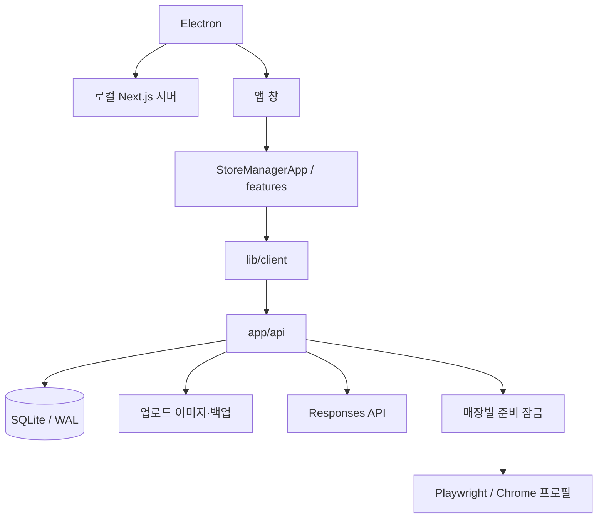

# 기술 설계와 구현 근거

[프로젝트 소개로 돌아가기](../README.md)

설명은 원본 커밋 [`58573ae`](https://github.com/saintlucias/BlogUploader/tree/58573ae6854cf8dd0944eabcecfe5a03c22d60fa)의 코드를 기준으로 합니다. 아래 내용은 현재 구현에서 확인한 설계와 효과이며, 개발자의 당시 의사결정을 인용한 회고는 아닙니다.

## 실행 구조

Electron이 로컬 Next.js 서버와 창의 생명주기를 관리합니다. `/` 진입 화면의 `StoreManagerApp`이 현재 매장·초안·화면 상태를 관리하며, 화면별 페이지 라우트는 없습니다. 클라이언트는 API를 통해 서버의 SQLite·파일·브라우저 자동화 모듈에 접근합니다.

구현 근거: [Electron 진입점](https://github.com/saintlucias/BlogUploader/blob/58573ae6854cf8dd0944eabcecfe5a03c22d60fa/electron/main.mjs), [StoreManagerApp](https://github.com/saintlucias/BlogUploader/blob/58573ae6854cf8dd0944eabcecfe5a03c22d60fa/features/shell/StoreManagerApp.tsx), [공용 타입](https://github.com/saintlucias/BlogUploader/blob/58573ae6854cf8dd0944eabcecfe5a03c22d60fa/types/store-manager.ts).

## 1. 화면 전환 중 초안 보존

**문제:** 자동 저장이 끝나기 전에 매장이나 초안을 전환하면 이전 데이터가 덮이거나 입력 내용을 잃을 수 있습니다.

**구현:** 약 700ms 지연 저장, 저장 큐, 문서·매장 식별 상태를 사용합니다. 전환 전에 대기 중인 저장을 완료하고, 저장 실패 시 전환을 중단합니다. DB는 변경 전 상태를 첫 변경과 이후 5분 간격으로 보관하며 문서당 최대 50개 버전을 유지합니다. 복원 전 현재 상태도 복구 지점으로 남깁니다.

**남은 제약:** 저장과 작업 실행이 클라이언트 수명에 영향을 받습니다. 모든 강제 종료 상황의 무손실을 보장하는 구조는 아닙니다.

구현 근거: [화면·저장 상태](https://github.com/saintlucias/BlogUploader/blob/58573ae6854cf8dd0944eabcecfe5a03c22d60fa/features/shell/StoreManagerApp.tsx), [문서·버전 저장](https://github.com/saintlucias/BlogUploader/blob/58573ae6854cf8dd0944eabcecfe5a03c22d60fa/lib/server/database.ts).

## 2. 플랫폼 부분 실패와 결과 보존

**문제:** 여러 플랫폼 중 하나에서 실패해도 앞선 성공 기록과 나머지 처리 결과를 확인할 수 있어야 합니다.

**구현:** 선택한 플랫폼을 순차 처리하고 각 처리 직후 결과를 저장합니다. 작업과 플랫폼별 항목을 분리해 전체 성공·부분 실패·실패를 표현합니다. 작업 이력에는 실제 게시물 URL을 수동으로 기록할 수 있습니다.

**남은 제약:** 순차 실행 주체가 클라이언트이므로 앱을 닫은 뒤 계속 실행되는 서버 작업 큐는 아닙니다. 실패 단계부터 재개하는 UI도 없습니다.

구현 근거: [게시 준비 흐름](https://github.com/saintlucias/BlogUploader/blob/58573ae6854cf8dd0944eabcecfe5a03c22d60fa/features/publishing/PublishView.tsx), [작업·항목 결과 저장](https://github.com/saintlucias/BlogUploader/blob/58573ae6854cf8dd0944eabcecfe5a03c22d60fa/lib/server/database.ts).

## 3. 브라우저 세션과 중복 실행

**문제:** 같은 매장의 입력 작업이 겹치거나 다른 계정의 편집기에 내용을 입력하면 결과가 잘못될 수 있습니다.

**구현:** 매장별 공유 Chrome 프로필과 플랫폼별 탭을 사용하고, 계정 주소와 세션 확인 상태를 관리합니다. 매장 단위 준비 잠금을 걸어 중복 입력을 제한합니다. 일부 플랫폼은 기존 사진이 남아 있으면 작업을 중단합니다.

**남은 제약:** 잠금은 단일 Node.js 프로세스의 메모리에 있으므로 여러 서버에 걸친 분산 잠금이 아닙니다. 외부 UI 구조와 로그인 상태 변경에 대응한 유지보수가 필요합니다.

구현 근거: [브라우저 프로필·검증 상태](https://github.com/saintlucias/BlogUploader/blob/58573ae6854cf8dd0944eabcecfe5a03c22d60fa/lib/server/publishing-browser.ts), [준비 잠금](https://github.com/saintlucias/BlogUploader/blob/58573ae6854cf8dd0944eabcecfe5a03c22d60fa/lib/server/preparation-lock.ts), [계정 주소 해석](https://github.com/saintlucias/BlogUploader/blob/58573ae6854cf8dd0944eabcecfe5a03c22d60fa/lib/server/platform-account-identity.ts).

## 4. 생성 결과의 구조와 공식 정보

**문제:** 플랫폼마다 필요한 원고 구조가 다르고, 주소·영업시간 등 공통 정보를 일관되게 반영해야 합니다.

**구현:** Responses API에 엄격한 JSON 스키마를 전달합니다. 저장된 말투 예시와 이미지 메타데이터를 포함하고, 공식 정보 블록은 프로그램에서 생성해 원고에 추가합니다. 생성 결과를 바로 편집 원고에 덮어쓰지 않고 검토 단계에 보관합니다.

**남은 제약:** 구조화된 응답은 사실성 보장과 다릅니다. 이미지 픽셀은 전달하지 않으며, 생성 문구의 사실 확인과 최종 적용은 사용자에게 남아 있습니다.

구현 근거: [생성·스키마·후처리](https://github.com/saintlucias/BlogUploader/blob/58573ae6854cf8dd0944eabcecfe5a03c22d60fa/lib/server/openai-content-generator.ts), [공식 정보 조합](https://github.com/saintlucias/BlogUploader/blob/58573ae6854cf8dd0944eabcecfe5a03c22d60fa/lib/official-store-information.ts), [GPT 검토 UI](https://github.com/saintlucias/BlogUploader/blob/58573ae6854cf8dd0944eabcecfe5a03c22d60fa/features/content/ContentCreationView.tsx).

## 5. 이미지 중복·참조와 복구

**문제:** 같은 사진의 반복 업로드로 용량이 늘고, 정리 중 이전 초안 버전의 이미지를 지울 수 있습니다. DB와 이미지가 따로 복원되면 참조가 어긋날 수 있습니다.

**구현:** 파일 시그니처와 MIME을 확인하고 SHA-256 파일명으로 중복 저장을 줄입니다. 미사용 파일 판정에 현재 초안과 이전 버전의 참조를 반영합니다. SQLite 스냅샷과 업로드 이미지를 함께 백업하며 복원 전 무결성을 검사하고 실패 시 롤백합니다.

**남은 제약:** 백업은 로컬 데이터 보호 기능이며 외부 동기화나 예약 자동 백업은 제공하지 않습니다.

구현 근거: [업로드 검증·해시](https://github.com/saintlucias/BlogUploader/blob/58573ae6854cf8dd0944eabcecfe5a03c22d60fa/app/api/uploads/route.ts), [이미지 참조와 DB 스냅샷](https://github.com/saintlucias/BlogUploader/blob/58573ae6854cf8dd0944eabcecfe5a03c22d60fa/lib/server/database.ts), [백업·롤백](https://github.com/saintlucias/BlogUploader/blob/58573ae6854cf8dd0944eabcecfe5a03c22d60fa/lib/server/backup-manager.ts).

## 검증 자료의 구분

원본에는 Node 테스트와 네이버 편집기 fixture가 있으며, 과거 점검 결과는 [원본 점검 보고서](https://github.com/saintlucias/BlogUploader/blob/58573ae6854cf8dd0944eabcecfe5a03c22d60fa/docs/PROJECT_REVIEW.md)에 있습니다. 해당 보고서의 테스트 수나 통과 결과를 이번 문서 작업의 실행 결과로 인용하지 않습니다.

이번에 직접 확인한 항목은 [출처·검증 범위](SOURCE.md)에 기재했습니다.
