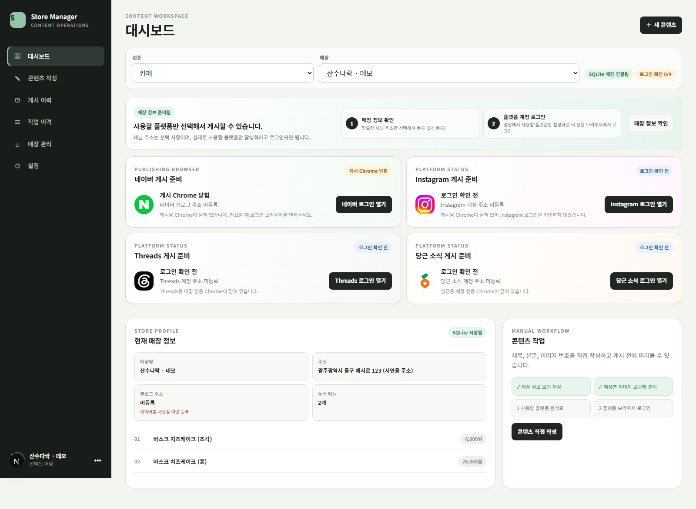
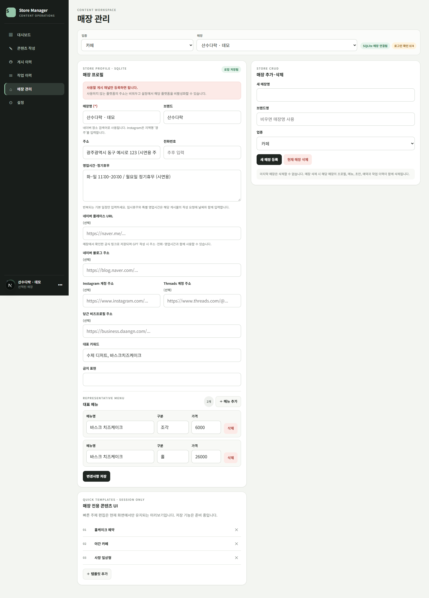
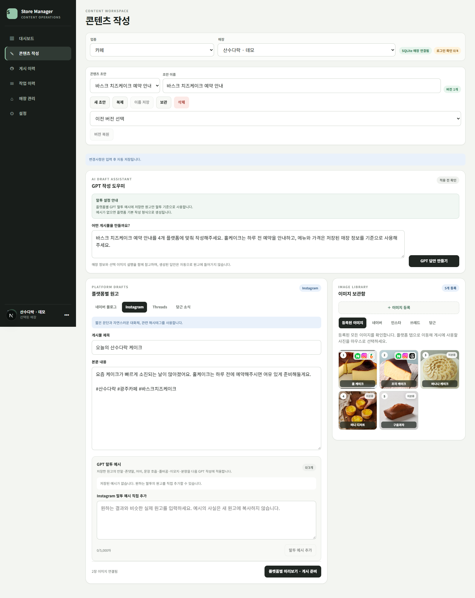
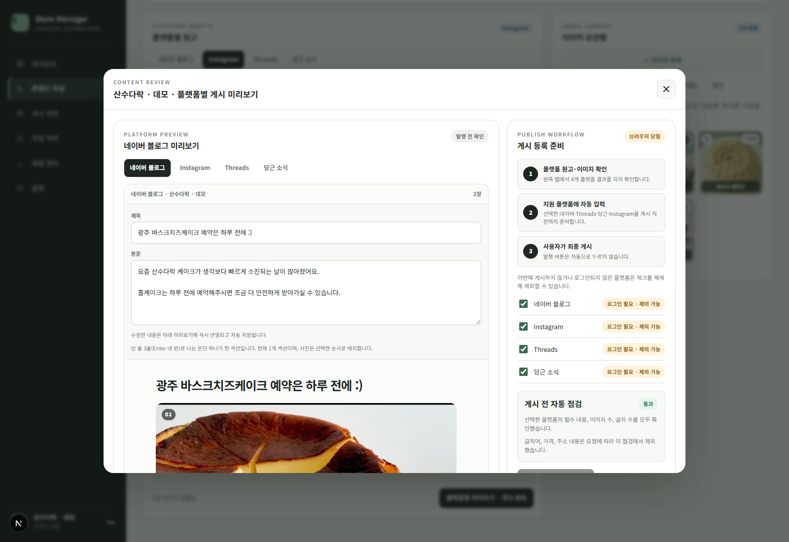
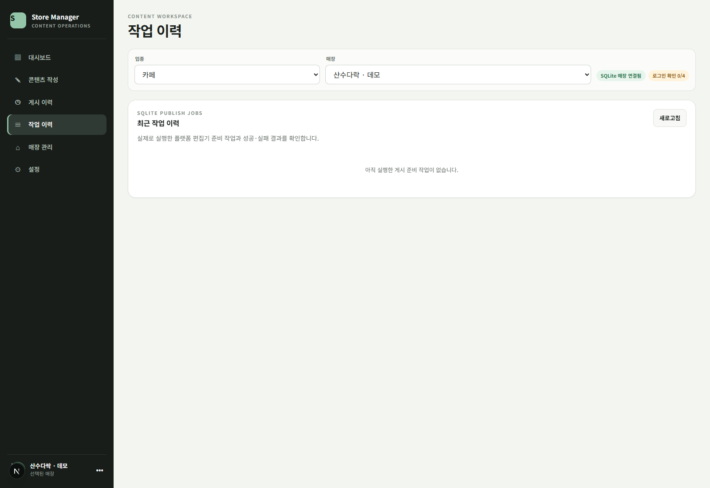
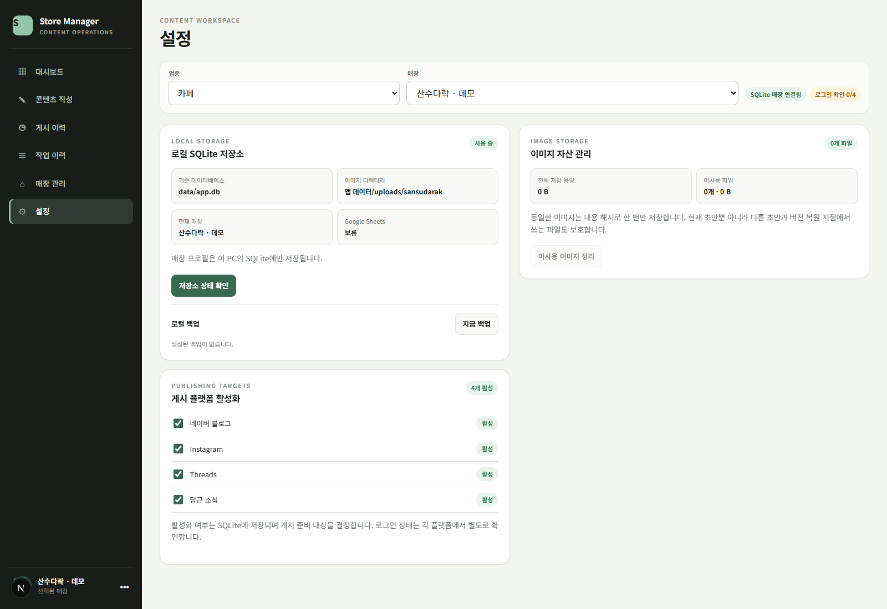

# 화면 안내

[프로젝트 소개로 돌아가기](../README.md)

모든 이미지는 v0.1.31 앱을 운영 데이터와 분리한 데모 DB에서 실행해 캡처했습니다. 원본의 기본 예시 원고·사진과 시연용 매장 정보를 사용했습니다. 외부 플랫폼은 로그인하지 않은 상태이며 GPT 생성 결과나 게시 성공 상태를 연출하지 않았습니다.

## 01. 대시보드

매장 컨텍스트, 초기 설정 안내와 4개 플랫폼 연결 상태를 한 화면에서 확인합니다. 채널을 실제로 연결하기 전의 상태가 표시됩니다.

## 02. 매장 관리

매장 프로필, 공식 정보, 메뉴·가격과 플랫폼 계정 주소를 관리합니다. 캡처의 주소·영업시간은 시연용이며 실제 매장 안내 정보가 아닙니다.

## 03. 콘텐츠 작성

초안 선택·복제·보관·버전 복원과 플랫폼별 원고 편집을 제공합니다. 오른쪽 이미지 보관함에서 플랫폼별 사진을 배정합니다. GPT 요청 문구가 입력된 상태이며 생성 요청은 실행하지 않았습니다.

## 04. Instagram 원고 편집

같은 초안에서 Instagram 탭으로 전환한 화면입니다. 플랫폼마다 다른 원고와 이미지 선택을 유지할 수 있습니다.

## 05. 게시 미리보기

플랫폼별 원고·사진을 확인하고, 이번 작업의 대상을 고릅니다. 계정 연결 전 상태로 캡처했으며 외부 편집기 자동 입력이나 실제 게시는 실행하지 않았습니다.

## 06. 작업 이력

작업별 진행 결과를 확인하는 화면입니다. 데모 환경에서 게시 준비를 실행하지 않았으므로 이력이 없는 초기 상태를 보여줍니다.

## 07. 설정

플랫폼 사용 여부, 저장소 상태, 이미지 자산과 로컬 백업·복원을 관리합니다. 캡처에서는 4개 플랫폼을 활성화한 상태입니다.

## 캡처 정보

| 항목 | 값 |
| --- | --- |
| 캡처일 | 2026-11-10, Asia/Seoul |
| 원본 | BlogUploader v0.1.31 / `58573ae` |
| 실행 환경 | Windows, Node.js 24.11.1, Next.js 개발 서버, Google Chrome headless |
| 브라우저 뷰포트 | 1600 × 1100 CSS px / device scale factor 1 |
| 이미지 범위 | 일반 화면은 전체 페이지, 게시 미리보기는 뷰포트 캡처. 모달 내부 스크롤 아래 내용은 이미지에 모두 담기지 않음 |
| 데이터 | 별도 SQLite DB, 기본 예시 원고·사진, 시연용 매장 프로필 |
| 외부 작업 | 계정 로그인·GPT 호출·외부 게시 없음 |

캡처를 위해 제품 UI 코드를 변경하거나 연결·성공 상태를 조작하지 않았습니다.
